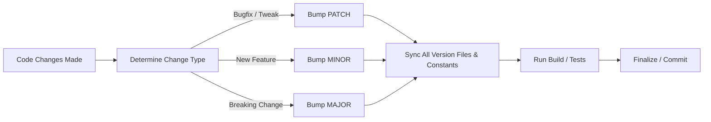

# Universal Automatic Version Bumping Rule (SemVer Protocol)

> **Mandatory Rule for Developers & AI Agents:**
> Whenever any code, feature, bug fix, or refactor is updated in the project, the version number **MUST BE INCREMENTED IMMEDIATELY** before concluding the task or committing code. Never make code changes without bumping and syncing all corresponding version references.

---

## 1. Versioning Standard (SemVer 2.0.0 + Patch)

Format: `MAJOR.MINOR.PATCH` (or `MAJOR.MINOR.PATCH` with sub-patch field if applicable)

| Change Type | Trigger | Increment | Example |
| :--- | :--- | :---: | :---: |
| **PATCH (Hotfix / Bugfix)** | Bug fixes, performance tweaks, CSS/UI touch-ups, small refactorings | `PATCH + 1` | `1.4.1` ➔ `1.4.2`<br>*(or `patch: 1` ➔ `patch: 2`)* |
| **MINOR (Feature)** | New features, new components, added endpoints/handlers (backward-compatible) | `MINOR + 1`<br>*(reset patch to 0)* | `1.4.2` ➔ `1.5.0` |
| **MAJOR (Breaking)** | Breaking architectural changes, protocol rework, backward-incompatible API changes | `MAJOR + 1`<br>*(reset minor & patch to 0)* | `1.5.0` ➔ `2.0.0` |

---

## 2. Multi-File Synchronization Matrix

Whenever the version is bumped, **ALL** files containing the version string must be updated simultaneously so they never go out of sync:

### Node.js / TypeScript / Web & Extensions
1. `package.json` ➔ `"version": "X.Y.Z"`
2. `package-lock.json` ➔ `"version": "X.Y.Z"` (or run `npm version --no-git-tag-version <new_version>`)
3. `manifest.json` ➔ `"version": "X.Y.Z"`, `"patch": N` (if applicable)
4. **Source Code Constants:**
   - Any in-code hardcoded version constants, e.g.:
     ```typescript
     export const CURRENT_VERSION = 'X.Y.Z';
     export const CURRENT_PATCH = N;
     ```

### Python Projects
1. `pyproject.toml` ➔ `version = "X.Y.Z"`
2. `setup.py` / `setup.cfg` ➔ `version="X.Y.Z"`
3. `__version__.py` or `<package>/__init__.py` ➔ `__version__ = "X.Y.Z"`

### Rust / Cargo
1. `Cargo.toml` ➔ `version = "X.Y.Z"`
2. `Cargo.lock` ➔ run `cargo check`

### C / C++ / Go / Desktop Apps
1. Header / Config files: `#define APP_VERSION "X.Y.Z"`
2. `version.rc` / `.res` resource files
3. Go: `const Version = "X.Y.Z"` in `version.go` or `main.go`

---

## 3. Strict Execution Workflow for AI / Developer

Every time a task involves modifying existing code or adding new code:



1. **Implement changes**: Write clean, working code.
2. **Evaluate change scope**: Decide whether it is a `PATCH`, `MINOR`, or `MAJOR`.
3. **Synchronize files**:
   - Edit all version-holding config files (`package.json`, `manifest.json`, etc.).
   - Edit any in-code version constants (`CURRENT_VERSION`, etc.).
4. **Verify build**: Ensure the project compiles/bundles with the new version cleanly.
5. **Changelog / Commit Message**: Reference the new version in the commit or response (e.g., `feat(queue): sync guest fake songs [bump to v1.4.2]`).

---

## 4. How to use this rule in any project

- **For AI Agents (Antigravity / Cursor / Windsurf / Claude Code):**
  - Save this file as `.agents/rules/auto-version.md` or `.cursorrules` or `.windsurfrules` in the root of any repository.
  - Or paste the content of section 1-3 into your global instructions / system prompt.
